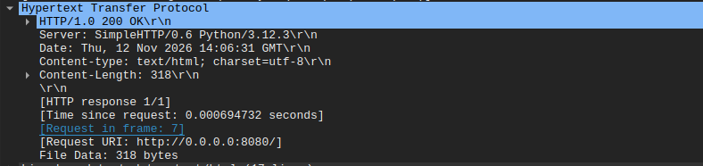

# Exercício 5 — Tráfego HTTP

## Como foi gerado

- Servidor HTTP local: `python3 -m http.server 8080`
- Interface capturada: `lo` (loopback)
- Acesso pelo navegador (Chrome) a `http://0.0.0.0:8080/`
- Filtro aplicado: `http`
- Arquivo: `captura_http.pcapng`

## O que foi observado

O navegador enviou uma requisição com o método GET para a URL
`http://0.0.0.0:8080/` (pacote 7), e o servidor respondeu com o status
`200 OK` em cerca de 0,7 ms (pacote 11). A resposta trouxe os cabeçalhos
`Content-Type: text/html; charset=utf-8` e `Server: SimpleHTTP/0.6 Python/3.12.3`,
com 318 bytes de conteúdo. Em seguida, o navegador pediu o `/favicon.ico`
(pacote 16), que retornou `404 File not found` (pacote 20), pois o arquivo não existe.

Foi usado um servidor local porque sites como www.google.com usam HTTPS: o
tráfego vai criptografado com TLS e não aparece no filtro `http`.

